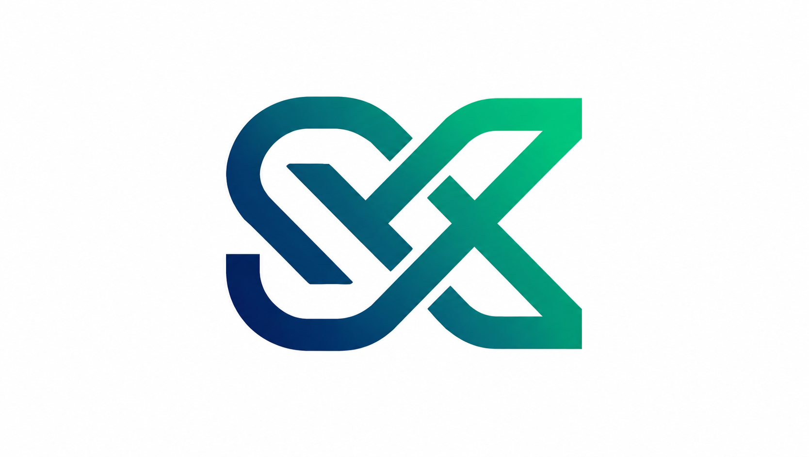

# 🚀 SYNEXAN — Agent Skill Hub

An enterprise-grade, developer-first management workstation and **Model Context Protocol (MCP)** server for storing, inspecting, authoring, and serving AI Agent skills (`.md`) backed by **MongoDB Atlas Cloud**.



---

## 🌟 Key Highlights

- **Master-Detail Engineering Workstation**: Designed following Anthropic's `frontend-design` guidance — zero generic SaaS-card noise, high-signal layout with dual-theme (Light & Dark) support.
- **26 Production-Ready Agent Skills**: Pre-loaded with battle-tested skills spanning **Computer Vision (YOLO/ViT)**, **Data Augmentation (Albumentations)**, **Model Training (QLoRA/DPO/Unsloth)**, **AI RAG (Semantic Chunking/HNSW)**, and **Fullstack Clean Architecture**.
- **Dual-Storage Engine (MongoDB Atlas + Graceful Fallback)**: Stores all skills, runbooks, and parameters in MongoDB Atlas. If offline or unconfigured, it seamlessly falls back to the local `skills/` filesystem cache without crashing.
- **Native MCP Server (Model Context Protocol)**: Exposes standard `list_skills`, `get_skill`, and `search_skills` tools so any AI Coding Agent (**Antigravity, Cursor, Claude Code, Windsurf**) can discover and invoke skills automatically.
- **GitHub-Style Safe Deletion**: Prevents accidental deletions by requiring exact type-to-confirm verification (`delete <skill-name>`).

---

## 🏗️ Architecture

```
Agent-Skills-Hub/
├── server/                      # Clean Architecture Backend Engine
│   ├── config/                  # MongoDB Connection & Env handling
│   ├── models/                  # Mongoose Skill Schema
│   ├── services/                # YAML Frontmatter Parser & Business Logic
│   ├── controllers/             # REST API Handlers (CRUD, Upload, Safe Delete)
│   ├── routes/                  # Express Router (/api/skills)
│   ├── mcp/                     # Native Stdio MCP Server Bridge
│   └── app.js                   # Server Entrypoint
│
├── public/                      # Master-Detail Workstation UI
│   ├── index.html               # Single-Page Application (Tailwind + Inter + Geist)
│   └── logo.png                 # Official SYNEXAN brand asset
│
├── skills/                      # 26 Standalone Markdown (.md) Skills
│   ├── vision-data-augmentation.md
│   ├── computer-vision-trainer.md
│   ├── model-evaluation-metrics.md
│   ├── llm-qlora-finetuner.md
│   ├── rag-chunking-evaluator.md
│   └── ... (21 more)
│
├── render.yaml                  # 1-Click Render Cloud Deployment Blueprint
├── run.bat                      # Windows 1-Click Startup Script
├── .env.example                 # Environment configuration template
└── package.json                 # Node.js ESM Dependencies
```

---

## ⚡ Quick Start

### 1. Clone & Install
```bash
git clone https://github.com/NguyenThanhThiet87/Agent-Skills-Hub.git
cd Agent-Skills-Hub
npm install
```

### 2. Configure Environment (`.env`)
Create a `.env` file in the project root:
```env
PORT=8080
NODE_ENV=production
MONGODB_URI=mongodb+srv://<username>:<password>@cluster0.xxx.mongodb.net/agent_skill_hub?retryWrites=true&w=majority
SKILLS_DIR=./skills
```
*(If `MONGODB_URI` is omitted, the hub automatically operates in Local Filesystem Mode).*

### 3. Launch Local Server
```bash
npm start
# Or double-click run.bat on Windows
```
Open **`http://localhost:8080`** in your browser.

---

## 🔌 Connecting AI Coding Agents (via MCP)

Add this entry to your agent's `mcp_config.json` (Antigravity, Claude Code, Cursor, Windsurf):

```json
{
  "mcpServers": {
    "agent-skill-hub": {
      "command": "node",
      "args": [
        "path/to/Agent-Skills-Hub/server/mcp/mcpBridge.js"
      ],
      "env": {
        "SKILLS_DIR": "./skills"
      }
    }
  }
}
```

### Available MCP Tools:
- `list_skills(category?)`: Lists all available skill metadata, triggers, and descriptions.
- `get_skill(name)`: Returns the complete markdown instructions and parameter schemas.
- `search_skills(query)`: Fuzzy-matches skills by task intent.

---

## ☁️ Deploying to Render Cloud

1. Push this repository to GitHub.
2. In [Render Dashboard](https://dashboard.render.com):
   - Click **New** $\rightarrow$ **Web Service**.
   - Connect this repository: `NguyenThanhThiet87/Agent-Skills-Hub`.
   - **Runtime**: `Node`
   - **Build Command**: `npm install`
   - **Start Command**: `node server/app.js`
3. In **Environment Variables**, add:
   - `MONGODB_URI`: *Your MongoDB connection string*
   - `NODE_ENV`: `production`
   - `SKILLS_DIR`: `./skills`

---

## 📄 License
Apache-2.0 © 2026 SYNEXAN Corporation.
